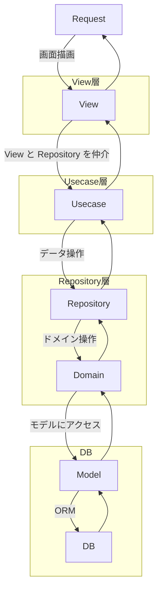

# Staff Attendance

勤怠入力、ワークフロー申請が可能な勤怠管理のSaaSシステム。

## システム

| 区分 | 構成 |
|------|------|
| Environment | Docker / devcontainer（Python 3.12） |
| Back-end | Python + Django 5.1 |
| Front-end | Next.js 16 + React 19 + Tailwind CSS 4 |
| Database | SQLite |

依存パッケージのバージョンは `.devcontainer/requirements.txt` で固定する。Django 6.0 以降は
SQLite 3.37 以上を要求するが、ベースイメージ（bullseye）の SQLite は 3.34 であるため、
5.1 系を使用する。

## フロントエンドの方針

Django テンプレートと Next.js が併存する状態を解消するため、二段階で進める。

1. 第一段階：Django テンプレートで機能を完成させる。新規の画面実装は Django テンプレート側に
   集約する。Next.js、Django REST Framework、django-cors-headers は撤去せず保持する。
2. 第二段階：機能が出揃った時点で API 化を行い、Next.js を SPA として構築する。
   Django テンプレートは段階的に廃止する。

現在は第一段階である。Next.js は導入のみで、`create-next-app` のテンプレートから未着手。

## 開発環境

### セットアップ

`.env.example` を `.env` として複製し、`SECRET_KEY` を設定する。

```bash
cp .env.example .env
```

devcontainer を使用する場合は VS Code から開く。ホストから直接操作する場合は
`Makefile` のタスクを使用する。

```bash
make build   # 開発用イメージをビルドする
make seed    # 初期データを投入する（migrate + loaddata）
make serve   # 開発サーバーを起動する（http://localhost:8000）
```

`make seed` は以下を投入する。

- `CodeMaster`：打刻・勤務場所・ワークフローのステータス（マイグレーション `0016`）
- `Department`：所属部署（`attendance/fixtures/departments.json`）

`CodeMaster` は各機能が前提とする必須マスタのためマイグレーションで投入する。
`Department` は組織固有のデータのため、フィクスチャとして環境ごとに置き換える。

### タスク

`make help` で一覧を表示する。主なタスクは以下。

| タスク | 内容 |
|--------|------|
| `make test` | テストを実行する |
| `make test-file T=<path>` | 指定したテストのみ実行する |
| `make check` | Django の構成チェックを実行する |
| `make migrations` | マイグレーションを作成する |
| `make lint` | flake8 で静的検査を実行する |
| `make db-backup` | DB を `backups/db/` に複製する（直近 10 世代を保持） |
| `make switch BRANCH=<name>` | DB を複製してからブランチを切り替える |
| `make createsuperuser` | 管理ユーザーを作成する（対話形式） |
| `make db-shell` | SQLite に接続する。`SQL="..."` を指定すると 1 文だけ実行する |
| `make shell` | コンテナのシェルを起動する |

`make lint` は違反を検出すると flake8 の仕様により終了コード 1 を返す。

### DB

DB は `staff_attendance/data/db.sqlite3` に置く。配置先とバックアップ先は `.env` の
`DB_PATH`・`DB_BACKUP_DIR` で変更できる。

- 旧コミットは `staff_attendance/db.sqlite3` を Git で追跡している。Git は ignore 対象のファイルを
  checkout 時に警告なく上書き・削除するため、DB はこの場所に置かない。
- ブランチの切り替えは `make switch BRANCH=<name>` を使用する。`git switch` を直接使う場合は、
  事前に `make db-backup` を実行する。
- `make db-backup` はサーバーの稼働中でも実行できる。出力先の表示はコンテナ内のパスとなる。
- コンテナに `sqlite3` コマンドがないため、`make db-shell` は Python 標準の `python -m sqlite3` で接続する。
  `manage.py dbshell` は使用できない。

### 画面

| URL | 画面 | 権限 |
|-----|------|------|
| `/` | ログイン | - |
| `/user_entry/` | ユーザー登録 | - |
| `/clock/` | 打刻 | 認証済み |
| `/clock/dashboard/` | ダッシュボード（日次集計） | 認証済み |
| `/clock/timesheets/` | 勤怠一覧（月次集計） | 認証済み |
| `/workflow/request/` | 申請メニュー | 認証済み |
| `/workflow/request/paid_leave/` | 有給申請 | 認証済み |
| `/workflow/` | ワークフロー選択 | スーパーユーザ |
| `/workflow/approval/` | 承認 | スーパーユーザ |
| `/admin/` | Django 管理画面 | スタッフ |

### ショートカットキー

認証済みの画面で使用できる。入力欄にフォーカスがある間は Esc のみ有効とする。

| キー | 操作 | アクション ID |
|------|------|---------------|
| `Alt+O` | サイドバーの開閉 | `sidebar.toggle` |
| `Esc` | サイドバーを閉じる | `sidebar.close` |

## アーキテクチャ

### 共通

ドメイン駆動設計で構築。



### バックエンド

```
staff_attendance/
├── attendance/				# urls.py はこの配下に置かない
│   ├── fixtures/
│   │   └── departments.json		# 所属部署の初期データ
│   ├── management/
│   │   └── commands/
│   │       └── runserver.py		# 静的ファイルをキャッシュさせない runserver
│   ├── migrations/
│   ├── models/				# モデル
│   │   ├── __init__.py
│   │   ├── clock_model.py
│   │   ├── code_master.py
│   │   ├── user_model.py
│   │   └── workflow_model.py
│   ├── static/
│   ├── templates/
│   │   ├── clock/			# 打刻画面のテンプレート
│   │   ├── user/			# ログイン、ユーザー登録画面のテンプレート
│   │   │   ├── login.html
│   │   │   └── user_entry.html
│   │   ├── workflow/			# 申請、承認画面のテンプレート
│   │   ├── base.html
│   │   ├── form.html
│   │   └── {other_templates}		# その他、ベースとなるテンプレート
│   └── tests/				# バックエンドのテスト
├── staff_attendance/
│   ├── clock/				# 打刻ドメイン user/ とほぼ同等の構成
│   ├── user/				# ユーザードメイン
│   │   ├── views/
│   │   │   ├── __init__.py
│   │   │   ├── login.py
│   │   │   ├── logout.py
│   │   │   └── user_entry.py		# 新規ユーザー登録
│   │   ├── domains.py
│   │   ├── forms.py
│   │   ├── repositories.py
│   │   ├── urls.py
│   │   └── usecases.py
│   ├── workflow/			# ワークフロードメイン
│   ├── settings.py
│   └── urls.py
└── util/				# ドメインに依存しない共通処理
    ├── base_form_view.py
    ├── base_repository.py
    ├── base_superuser_view.py
    ├── base_user_view.py
    ├── code_master_repository.py
    ├── id_generator.py
    ├── mixins.py
    ├── now.py
    ├── round_calc.py
    ├── shortcuts.py			# ショートカットキーの割り当て
    ├── static_handlers.py		# 開発サーバーの静的ファイル配信
    ├── storages.py			# 静的ファイルのストレージ
    └── test_runner.py			# テストランナー
```

### 静的ファイル

ブラウザが変更前のファイルをキャッシュから読み込むことを防ぐため、環境ごとに以下の対策を取る。

| 環境 | 対策 | 実装 |
|------|------|------|
| 開発 [DEBUG=True] | `runserver` が静的ファイルの応答に `Cache-Control: no-cache` を付与する。未変更のファイルには 304 を返す | `attendance/management/commands/runserver.py`、`util/static_handlers.py` |
| 本番 [DEBUG=False] | ファイル名に内容のハッシュを付与して配信する。ES Modules の import 先もハッシュ付きの名前に書き換える | `util/storages.py` [ManifestStaticFilesStorage を継承] |

- DEBUG=False で起動する前に `make collectstatic` を実行し、`STATIC_ROOT` にファイルとマニフェストを生成する。未収集のファイルを参照するとページの描画時に例外となる。
- DEBUG=False では Django は静的ファイルを配信しない。本番の配信方法は未定義である。
- テストは DEBUG=False で実行されるため、テストランナー [`util/test_runner.py`] がストレージを `StaticFilesStorage` に切り替える。
- `runserver` を拡張しているため、`INSTALLED_APPS` では `attendance` を `django.contrib.staticfiles` より前に記載する。

### ショートカットキー

割り当て・アクション・キー入力の処理を分離する。

| 役割 | 配置 |
|------|------|
| 割り当て | `util/shortcuts.py`。アクション ID とキー表記のリストを対応させ、コンテキストプロセッサ `shortcut_bindings` で `frame.html` に JSON として埋め込む |
| アクション | `static/js/shortcuts/actions.js` に登録する。画面側のモジュールが ID と処理を登録する [e.g. `toggle.js`] |
| キー入力 | `static/js/shortcuts/keymap.js`。キー入力を正規化し、割り当てを引いてアクションを実行する |

キー表記は修飾キー [`Ctrl` `Alt` `Shift` `Meta`] と主キーを `+` で連結する [e.g. `Alt+O`]。
ユーザー単位で割り当てを変更する場合は `resolve_shortcuts` で既定値を上書きする。

### フロントエンド

```
frontend/
├── app/	# create-next-app のテンプレート
└── public/
```

## 構築状況

### バックエンド

| 機能 | 状態 |
|------|------|
| ドメインモデルの作成 | 完了 |
| ログイン、ログアウト | 完了 |
| ユーザー登録 | 完了 |
| 打刻（IN / OUT、勤務場所、休憩時間） | 完了 |
| 日次集計 | 完了 |
| 月次集計 | 完了 |
| 有給申請、承認 | 完了 |
| 打刻修正、交通費、勤怠締め | モデルのみ。Usecase / View は未実装 |
| 承認ルート、有給の付与・管理、給与集計 | 未着手 |
| テスト | 111 件 |

### フロントエンド

| 項目 | 状態 |
|------|------|
| Next.js の導入 | 完了 |
| 画面実装 | 未着手（`create-next-app` のテンプレートのまま） |
| API（Django REST Framework） | 未着手（パッケージの導入のみ） |
