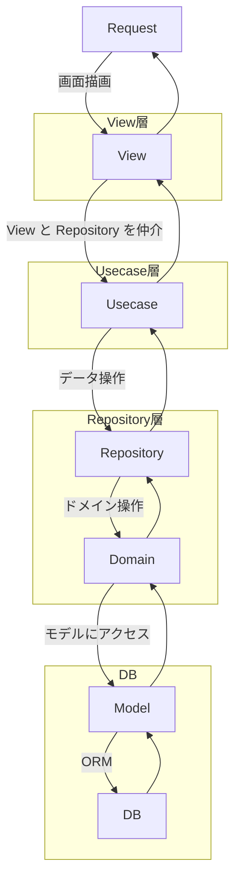

# アーキテクチャ

## レイヤー構成

ドメインごとに View・Usecase・Repository・Domain を分け、Model へのアクセスは Repository に限定する。



| 層 | 責務 | 配置 |
|---|---|---|
| View | リクエストの受付、入力値の検証 [Form]、テンプレートの描画 | `features/{domain}/views` |
| Usecase | 業務処理。Repository を組み合わせ、Domain を生成する | `features/{domain}/usecases` |
| Repository | Model の検索・保存。`util.base_repository.BaseRepository` を継承する | `features/{domain}/repositories.py` |
| Domain | 層の間で受け渡すデータ。`dataclass` で定義する | `features/{domain}/domains.py` |
| Model | テーブル定義。全ドメインのモデルを `attendance` アプリに集約する | `attendance/models/` |

`features/workflow/` は、種別を問わない処理 [承認、`Workflow` の作成・更新] を直下に、種別ごとの処理を `paid_leave/` 等のサブパッケージに置く。依存は「種別 → 共通」の一方向とする。

## ディレクトリ構成

```
staff_attendance/                   # リポジトリのルート
├── .claude/                        # Claude Code の skill・rule・hook
├── .devcontainer/                  # 開発用イメージ [Dockerfile、requirements.txt、.flake8]
├── Makefile                        # 開発タスク
├── docs/                           # 仕様書
├── frontend/                       # Next.js [導入のみ]
└── backend/                        # Django プロジェクト [BASE_DIR]
    ├── manage.py
    ├── data/                       # SQLite の DB [Git 管理外。.gitkeep のみ追跡]
    ├── attendance/                 # モデル・テンプレート・静的ファイル・テストを持つアプリ
    │   ├── admin.py
    │   ├── apps.py
    │   ├── fixtures/
    │   │   └── departments.json
    │   ├── management/
    │   │   └── commands/
    │   │       ├── backup_db.py
    │   │       └── runserver.py
    │   ├── migrations/
    │   ├── models/
    │   │   ├── clock_model.py
    │   │   ├── code_master.py
    │   │   ├── user_model.py
    │   │   └── workflow_model.py
    │   ├── static/
    │   │   ├── css/
    │   │   └── js/
    │   ├── templates/
    │   └── tests/
    ├── config/                     # プロジェクトの設定 [settings・ルートの urls・wsgi・asgi]
    │   ├── asgi.py
    │   ├── settings.py
    │   ├── urls.py
    │   └── wsgi.py
    ├── features/                   # ドメインごとの実装 [View・Usecase・Repository・Domain]
    │   ├── user/
    │   │   ├── views/
    │   │   ├── domains.py
    │   │   ├── forms.py
    │   │   ├── repositories.py
    │   │   ├── urls.py
    │   │   └── usecases.py
    │   ├── clock/
    │   │   ├── forms/
    │   │   ├── usecases/
    │   │   ├── views/
    │   │   ├── domains.py
    │   │   ├── repositories.py
    │   │   └── urls.py
    │   └── workflow/
    │       ├── paid_leave/
    │       ├── domains.py
    │       ├── repositories.py
    │       ├── urls.py
    │       ├── usecases.py
    │       └── views.py
    └── util/                       # ドメインに依存しない共通処理
        ├── base_form_view.py
        ├── base_repository.py
        ├── base_superuser_view.py
        ├── base_user_view.py
        ├── code_master_repository.py
        ├── id_generator.py
        ├── mixins.py
        ├── now.py
        ├── round_calc.py
        ├── shortcuts.py
        ├── static_handlers.py
        ├── storages.py
        └── test_runner.py
```

- `urls.py` は `attendance/` 配下に置かず、`features/` 配下のドメインごとに置く。ルートの `config/urls.py` が各ドメインの `urls.py` を `include` する。

## 共通処理 [util/]

| モジュール | 内容 |
|---|---|
| `base_form_view.py` | `BaseFormView`。GET でフォームを表示し、POST で検証後に `form_valid` をトランザクション内で実行して `success_url` へリダイレクトする。`IntegrityError` は「This record already exists.」としてフォームに表示する。フォームには `user` を渡す |
| `base_user_view.py` | `BaseUserView`。認証済みユーザー向けに `template` を描画する |
| `base_superuser_view.py` | `BaseSuperUserView`。HTTP メソッドを問わず、スーパーユーザーでない認証済みユーザーには `403.html` を status 403 で返す |
| `mixins.py` | `CustomLoginRequiredMixin`。未認証のユーザーをログイン画面へリダイレクトする |
| `base_repository.py` | `BaseRepository`。`get` / `get_all` / `filter` / `create` を提供する |
| `code_master_repository.py` | 打刻種別・ワークフローのステータスを `CodeMaster` から辞書で返す |
| `id_generator.py` | 数字 6 桁のランダムな ID を生成する |
| `now.py` | 現在の日付・時刻の取得と文字列化 [`%Y-%m-%d` / `%H:%M`] |
| `round_calc.py` | 時刻の分単位への切り捨て、15 分単位の切り上げ・切り捨て |
| `shortcuts.py` | ショートカットキーの割り当てとコンテキストプロセッサ。[frontend.md](frontend.md#ショートカットキー) を参照 |
| `static_handlers.py`、`storages.py`、`test_runner.py` | 静的ファイルの配信。[development.md](development.md#静的ファイルの配信) を参照 |

## 設定

### 環境変数

リポジトリのルートの `.env` から読み込む。雛形は `.env.example` にある。

| 変数 | 既定値 | 内容 |
|---|---|---|
| `SECRET_KEY` | なし [必須] | Django の秘密鍵 |
| `DEBUG` | `False` | デバッグモード |
| `ALLOWED_HOSTS` | `localhost,127.0.0.1` | 許可するホスト名 |
| `CORS_ALLOWED_ORIGINS` | `http://localhost:3000` | CORS を許可するオリジン [Next.js 用] |
| `DB_PATH` | `backend/data/db.sqlite3` | SQLite の DB。相対パスはリポジトリのルートが起点 |
| `DB_BACKUP_DIR` | `backups/db` | `backup_db` の出力先。相対パスはリポジトリのルートが起点 |

### 主な設定値

| 項目 | 値 | 備考 |
|---|---|---|
| `AUTH_USER_MODEL` | `attendance.User` | |
| `LOGIN_URL` | `/` | ログイン画面 |
| `SESSION_COOKIE_AGE` | 3600 秒 | ブラウザを閉じるとセッションも破棄する |
| パスワードの最小長 | 9 文字 | Django 標準の検証 4 種を使用する |
| `LANGUAGE_CODE` / `TIME_ZONE` | `en` / `Asia/Tokyo` | `USE_TZ = True` |
| `EMAIL_BACKEND` | コンソール出力 | メール送信は未実装 |
| コンテキストプロセッサ | `util.shortcuts.shortcut_bindings` を追加 | |
| `INSTALLED_APPS` | `attendance` を `django.contrib.staticfiles` より前に記載 | `runserver` を拡張しているため |
