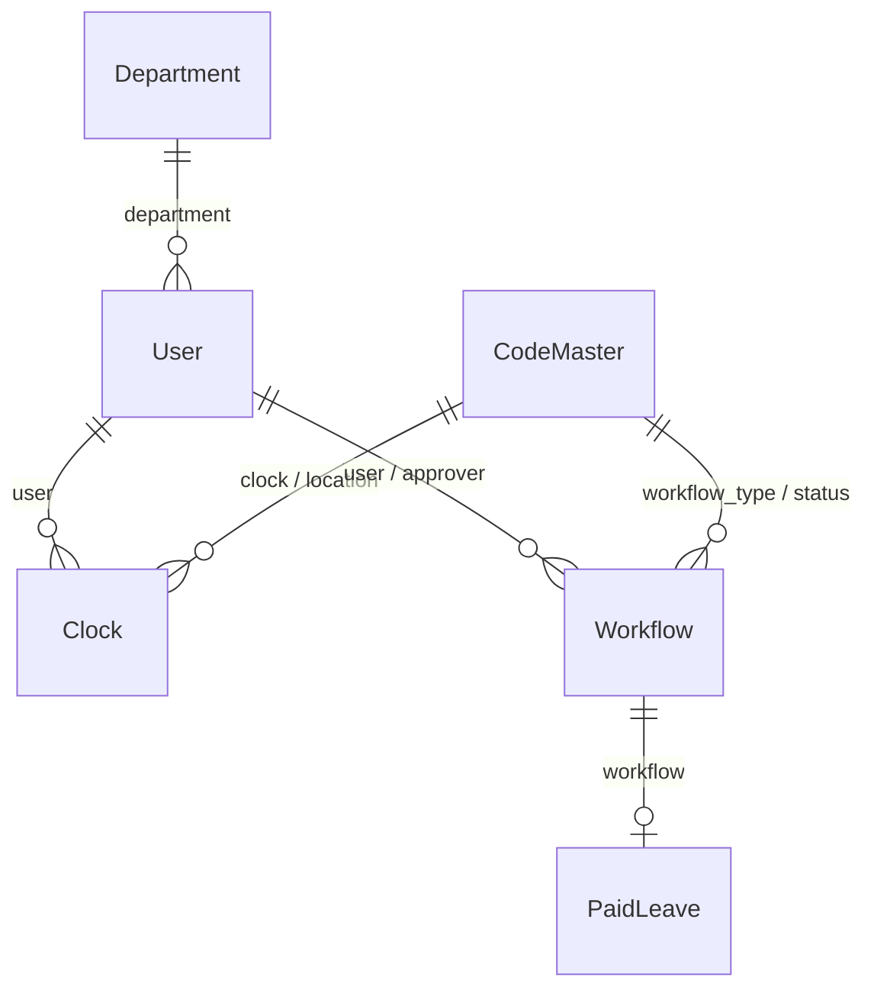

# データモデル

モデルは `attendance/models/` に定義する。

`ClockCorrect` / `Fare` / `PayPeriod` は `PaidLeave` と同じく `WorkflowDetailBase` を継承し、`Workflow` と 1 対 1 で結び付く。

## User [`user_model.py`]

`AbstractUser` を継承する。`AUTH_USER_MODEL = "attendance.User"`

| フィールド | 型 | 内容 |
|---|---|---|
| `user_id` | `CharField(6)` | 主キー。数字 6 桁。編集不可 |
| `department` | `ForeignKey(Department)` | 所属部署。部署の削除時は NULL |
| その他 | | `username`、`email`、`password`、`is_superuser` 等は `AbstractUser` の定義に従う |

## Department [`user_model.py`]

| フィールド | 型 | 内容 |
|---|---|---|
| `name` | `CharField(100)` | 部署名 |

初期データは `attendance/fixtures/departments.json` [5 件] にあり、`make loaddata` で投入する。組織固有のデータのため、環境ごとに置き換える。

## CodeMaster [`code_master.py`]

区分 [`code_type`] とコード [`code`] の組で一意とする。

| `code_type` | `code` | `description` | 用途 |
|---|---|---|---|
| `clock` | `0` / `1` | In / Out | 打刻種別 |
| `location` | `0` / `1` | Office / Telework | 勤務場所 |
| `workflow_status` | `0` / `1` / `2` | Pending / Approved / Rejected | ワークフローのステータス |
| `workflow_type` | `0` / `1` / `2` / `3` | Paid Leave / Clock Correct / Fare / Pay Period | ワークフローの種別 |

- 各機能が前提とする必須マスタのため、マイグレーションで投入する [`0016_seed_code_master`。`workflow_type` は `0018_workflow`]。既存データがある場合は追加しない [`get_or_create`]
- 逆マイグレーションでは削除しない。打刻・申請データが `PROTECT` で参照しているためである。

## Clock [`clock_model.py`]

| フィールド | 型 | 内容 |
|---|---|---|
| `user` | `ForeignKey(User)` | ユーザーの削除時は打刻も削除する |
| `date_stamp` | `DateField` | 日付。既定値は当日 |
| `time_stamp` | `TimeField` | 時刻。既定値は現在時刻 |
| `clock` | `ForeignKey(CodeMaster)` | 打刻種別 [`code_type="clock"`]。`PROTECT` |
| `break_time` | `DecimalField(4, 2)` | 休憩時間 [時間]。既定値 1.00 |
| `location` | `ForeignKey(CodeMaster)` | 勤務場所 [`code_type="location"`]。`PROTECT` |

- `user`・`date_stamp`・`clock` の組で一意とする [1 日に IN / OUT を 1 件ずつ]

## ワークフロー [`workflow_model.py`]

ワークフローは、全種別に共通する項目を持つ `Workflow` と、種別ごとの項目を持つ詳細テーブルで構成する。

### Workflow

| フィールド | 型 | 内容 |
|---|---|---|
| `id` | `BigAutoField` | ワークフロー ID。全種別で一意。承認画面の POST キーに使う |
| `workflow_type` | `ForeignKey(CodeMaster)` | 種別 [`code_type="workflow_type"`]。`PROTECT` |
| `user` | `ForeignKey(User)` | 申請者。削除時は申請も削除する |
| `status` | `ForeignKey(CodeMaster)` | ステータス [`code_type="workflow_status"`]。`PROTECT` |
| `approver` | `ForeignKey(User)` | 承認者。任意。削除時は NULL |
| `created_at` / `updated_at` | `DateTimeField` | 作成・更新日時 |

### 詳細テーブル

抽象モデル `WorkflowDetailBase` を継承し、`workflow` [`OneToOneField(Workflow)`] で共通テーブルと結び付く。`Workflow` の削除時は詳細も削除する。共通テーブルからは `workflow.paidleave` のように小文字のクラス名で参照する。

| モデル | 固有フィールド | 状態 |
|---|---|---|
| `PaidLeave` | `start_date`、`end_date` [既定値は当日]、`reason` [任意] | 申請・承認を実装済み |
| `ClockCorrect` | `original_time`、`corrected_time`、`date`、`reason` [任意] | モデルのみ |
| `Fare` | `date`、`amount` [`DecimalField(10, 2)`]、`route` | モデルのみ |
| `PayPeriod` | `month` | モデルのみ |

## 管理画面

全モデルを `/admin/` に登録している。`CodeMaster` は区分での絞り込みと検索、`Clock` はユーザー・日付・種別・勤務場所での絞り込み、`Workflow` は種別・ステータスでの絞り込みに対応する。

## マイグレーション

| 番号 | 内容 |
|---|---|
| `0001`〜`0011` | `User`・`Department`・`Clock` の作成と、`Clock` の一意制約・フィールド定義の調整 |
| `0012` | `CodeMaster` とワークフローの 4 モデルを追加 |
| `0013`〜`0014` | `Clock`・`User`・ワークフローの外部キーの定義を変更 |
| `0015` | `WorkflowBase.status` の不正な既定値を削除 |
| `0016` | `CodeMaster` の初期データを投入 |
| `0017` | `Clock` の外部キーの不正な既定値を削除 |
| `0018` | `workflow_type` のコードを投入し、`Workflow` を作成。詳細テーブルに `workflow` を追加 [一時的に NULL を許可] |
| `0019` | `PaidLeave` の共通項目を `Workflow` に移す。`Workflow.id` は `PaidLeave.id` と同じ値とし、作成・更新日時を引き継ぐ |
| `0020` | 詳細テーブルの `workflow` を必須とし、共通項目を削除 |

`0020` は、データがある状態では逆方向に適用できない。戻す場合は、適用前に複製した DB [`make db-backup`] から復元する。
