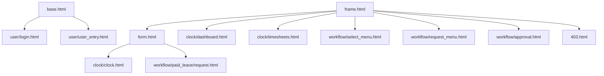

# フロントエンド [Django テンプレート]

テンプレートは `attendance/templates/`、静的ファイルは `attendance/static/` に置く。Next.js [`frontend/`] は導入のみで、画面は未実装である。

## テンプレートの継承

| テンプレート | 役割 |
|---|---|
| `base.html` | 未認証の画面の枠。ヘッダーの時計と Dark Mode を読み込む |
| `frame.html` | 認証済みの画面の枠。`base.html` の内容に加えて、サイドバー [`sidebar.html`]、ログインユーザー名、ショートカットキーを読み込む。`html` 要素の `data-sidebar` でサイドバーの状態を表す |
| `form.html` | 入力フォームの共通部分。フィールド・エラー・送信ボタンを描画し、送信時に確認ダイアログを表示する。`form_title` / `btn` / `footer` ブロックを持つ |
| `sidebar.html` | 開閉ボタン、メニュー [Dashboard / Clock / Timesheets / Workflow / Administration] とログアウト、幕。表示中の画面のメニューに `aria-current="page"` を付与する |
| `icons/*.html` | メニューのアイコン [SVG]。Lucide [ISC License、`icons/lucide_license.txt`] の図形を使用する |

ブロックは `title`・`header` [CSS の読み込み]・`body`・`script` を持つ。`base.html`・`frame.html` は `header` ブロックの後に `responsive.css` を読み込む。

## CSS

| ファイル | 読み込む画面 | 内容 |
|---|---|---|
| `base.css` | ログイン、403、ワークフロー選択、申請メニュー | 共通の書体・カード [`form` / `.card`]・入力欄・ボタン・`.workflow` / `.message` |
| `form.css` | `form.html` を継承する画面、ユーザー登録 | `base.css` のフォーム向けの派生 |
| `workflow.css` | 承認、ダッシュボード、勤怠一覧 | `base.css` の派生に、表 [`table` / `th` / `td`] を加えたもの |
| `panel.css` | ダッシュボード、勤怠一覧 | 期間を選択して集計表を表示する画面の共通部分 [`.panel` / `.period-picker` / `.period-nav`]。`workflow.css` の後に読み込む |
| `timesheets.css` | 勤怠一覧 | 土日の文字色。`panel.css` の後に読み込む |
| `sidebar.css` | 認証済みの全画面 [`frame.html`] | サイドバー・開閉ボタン・幕、固定時の本文の余白 |
| `responsive.css` | 全画面 [`base.html` / `frame.html`] | 画面幅に応じた共通の上書きと、表の横スクロール [`.table-scroll`]。各画面の CSS の後に読み込む |

- `base.css`・`form.css`・`workflow.css` には同名のクラスの定義が重複している。共通化は未対応である。
- 色を変更する場合は、[テーマカラー](#テーマカラー) の規則に従う。

## JavaScript

| ファイル | 読み込み | 内容 |
|---|---|---|
| `time.js` | `base.html` / `frame.html` | ヘッダーの時計 [`YYYY.MM.DD hh:mm:ss`] を 1 秒ごとに更新する |
| `darkmode.js` | `base.html` / `frame.html` | darkmode-js [CDN、1.5.7] の切り替えボタンを表示する。OS の設定に追従する |
| `sidebar_state.js` | `frame.html` の head [同期] | サイドバーの固定状態の保存・復元 [`localStorage`、キー `sidebar.pinned`] と表示方式の判定。`window.sidebarState` として公開する |
| `toggle.js` | `frame.html` [ES Modules] | サイドバーの状態の切り替え。アクション `sidebar.toggle` / `sidebar.close` を登録する |
| `shortcuts/actions.js` | `toggle.js` から import | アクション ID と処理の登録先 |
| `shortcuts/keymap.js` | `main.js` から import | キー入力を割り当てと照合し、アクションを実行する |
| `shortcuts/main.js` | `frame.html` [ES Modules] | ページに埋め込まれた割り当てを読み込み、キー入力の受付を開始する |
| `confirm.js` | `form.html`、ユーザー登録、承認 | フォーム送信時に確認ダイアログを表示する |
| `selected_date.js` | なし | 未使用 |

## サイドバー

開閉ボタンは画面左上に固定し、サイドバーは画面端から 12px 離したフローティング表示とする。状態は `html` 要素の `data-sidebar` で表し、`toggle.js` が切り替える。

| 状態 | 契機 | 表示 |
|---|---|---|
| `closed` | 初期状態 | 非表示 |
| `peek` | 開閉ボタンにカーソルを合わせる | 本文に重ねて表示する。カーソルがボタンとサイドバーの両方から外れて 300ms 後に閉じる |
| `pinned` | 開閉ボタンのクリック [`peek` / `closed` から] | 固定表示。本文の左に余白 [サイドバーの幅 + 24px] を取る。再クリックで `closed` に戻す |
| `open` | オーバーレイ表示での開閉ボタンのクリック | 幕を付けて本文に重ねて表示する。幕のクリックで閉じる |

- 幅 900px 未満、またはホバーできない端末 [`(hover: none)`] ではオーバーレイ表示とし、`peek`・`pinned` を使用しない。判定条件は `sidebar_state.js` の `OVERLAY_QUERY` と `sidebar.css`・`responsive.css` の 900px で揃える。
- `pinned` の状態は `localStorage` に保存し、画面遷移後も維持する。保存値は描画前に `sidebar_state.js` が `data-sidebar` に反映する。保存できない環境では固定していない状態として扱う。
- 表示方式が切り替わった場合 [画面幅の変更] は、保存値から状態を復元する。
- 幕はサイドバーより下の層 [`z-index`] に置き、サイドバー上のクリックを受けない。
- 開閉ボタンは `peek` では三本線、`pinned` / `open` では × を表示し、`aria-expanded` に表示の有無を反映する。

## レスポンシブ対応

`responsive.css` に、幅に関わる上書きを集約する。

| 幅 | 対応 |
|---|---|
| 900px 未満 | ヘッダーを折り返し可能とし、左右の余白を縮小する [認証済みの画面では開閉ボタンの幅 72px を空ける]。`.main` の最大幅を解除する。`form` / `.card` / `.panel` を画面幅に収める |
| 600px 未満 | `form` / `.card` / `.panel` を幅 100%・高さ自動とする。見出し・ボタンの余白を縮小し、入力欄 [`.field` / `.certificate`] を横幅いっぱいに広げる。期間の選択欄を折り返し可能とする |

- 表は `.table-scroll` で囲み、表のみ横スクロールさせる [ダッシュボード・勤怠一覧・承認]

## ショートカットキー

認証済みの画面 [`frame.html`] で使用できる。入力欄にフォーカスがある間は Esc のみ有効とする。

| キー | 操作 | アクション ID |
|---|---|---|
| `Alt+O` | サイドバーの固定の切り替え [オーバーレイ表示では開閉] | `sidebar.toggle` |
| `Esc` | 一時表示・オーバーレイ表示のサイドバーを閉じる [固定は解除しない] | `sidebar.close` |

割り当て・アクション・キー入力の処理を分離する。

| 役割 | 配置 |
|---|---|
| 割り当て | `util/shortcuts.py`。アクション ID とキー表記のリストを対応させ、コンテキストプロセッサ `shortcut_bindings` で `frame.html` に JSON として埋め込む [`json_script`、id `shortcut-bindings`] |
| アクション | `static/js/shortcuts/actions.js` に登録する。画面側のモジュールが ID と処理を登録する [e.g. `toggle.js`] |
| キー入力 | `static/js/shortcuts/keymap.js`。キー入力を正規化し、割り当てを引いてアクションを実行する |

- キー表記は修飾キー [`Ctrl` `Alt` `Shift` `Meta`] と主キーを `+` で連結する [e.g. `Alt+O`]。表記の揺れ [`alt+o` 等] は正規化する。
- 英数字は物理キー [`event.code`] から判定する。Alt との組み合わせで別の文字が入力される環境に対応するためである。
- 同じキーを複数のアクションに割り当てた場合は、先の割り当てを有効とし、コンソールに警告を出す。
- アクションが `false` を返した場合はキーの既定動作を妨げない [e.g. サイドバーが閉じている時・固定中の Esc]
- ユーザー単位で割り当てを変更する場合は `resolve_shortcuts` で既定値を上書きする。

## テーマカラー

Dark Mode は darkmode-js が `mix-blend-mode: difference` で画面全体を反転して表示する。

| 項目 | 内容 |
|---|---|
| ページの背景 | Light `#e1e1d7` / Dark `#1e1e28` [反転色] |
| 表の背景 | `th` `#27292d`、`td` `#202122`。Dark では反転して明るい背景となる |
| 色の指定 | Light の値で指定する。Dark で見える色は指定した色の反転色となる |
| 色相の保持 | 有彩色で色相を保つ必要がある場合は、`body.darkmode--activated` で反転後に意図した色となる値を上書きする |
| コントラスト比 | Light / Dark の両方で、背景に対して 4.5:1 以上とする |

- 色は CSS 変数で指定し、変数名は `--{ファイル名}_{役割}` とする。`base.css` の共通色は `--{役割}` とする。
- `isolation: isolate` は要素を反転の対象外とし、Light / Dark で同じ見た目となるため使用しない。既存の `.error` 等に残る指定は、CSS の共通化の際に解消する。
- 配色の算出・検査・撮影の手順は `.claude/skills/theme-color/` に定義する。
- darkmode-js は反転用のレイヤー [`z-index` 指定なし] を `body` の先頭に挿入する。`position: fixed` かつ `z-index` を持つ要素 [サイドバー・開閉ボタン・幕] はレイヤーより上に描画され、反転されない。これらの Dark の値は表示する色をそのまま `body.darkmode--activated` で指定する。

採用している色:

| 変数 | Light | Dark の上書き値 | Dark での表示 |
|---|---|---|---|
| `--alert_color` [`base.css`] | `#b3261e` | `#00949e` | `#ff6b61` |
| `--timesheets_sunday` | `#ff8a8a` | `#48e3e3` | `#b71c1c` |
| `--timesheets_saturday` | `#8ab8ff` | `#f2b85e` | `#0d47a1` |
| `--panel_link_on_page` | `#1f6b6b` | なし | `#e09494` [色相の変化を許容] |
| `--panel_link_on_table` | `#66cccc` | なし | `#993333` [色相の変化を許容] |

サイドバーの色 [`sidebar.css`。反転されないため、Dark の値がそのまま表示される]:

| 変数 | Light | Dark | コントラスト比 [Light / Dark] |
|---|---|---|---|
| `--sidebar_background` | `#132032` | `#1b2940` | - |
| `--sidebar_text` | `#c3cad6` | 同左 | 背景に対し 9.95:1 / 8.86:1 |
| `--sidebar_hover_background` | `#1e2b42` | `#25344f` | 文字に対し 8.61:1 / 7.57:1 |
| `--sidebar_active_background` | `#2b3648` | `#31415f` | - |
| `--sidebar_active_text` | `#ffffff` | 同左 | 現在のページの背景に対し 12.18:1 / 10.23:1 |
| `--sidebar_border` | `transparent` | `rgba(255,255,255,.08)` | - |
| `--sidebar_toggle_on_page` | `#132032` | `#c3cad6` | ページの背景に対し 12.46:1 / 10.02:1 |
